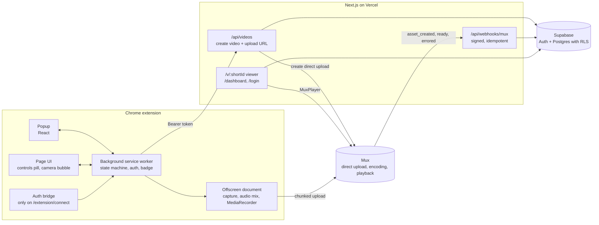
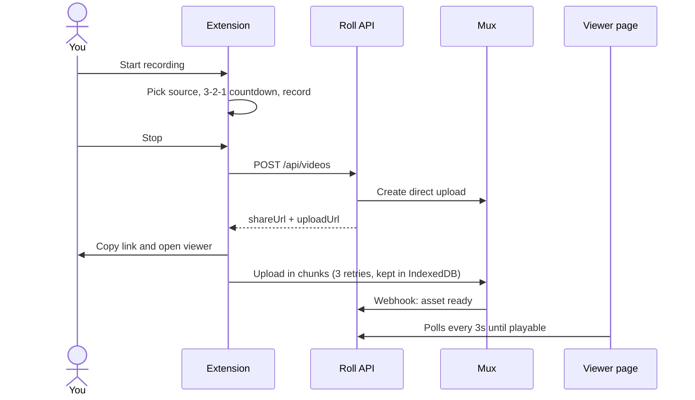

<p align="center">
  
</p>

<h1 align="center">Roll</h1>

<p align="center">
  Record your screen, camera and voice from Chrome. Press stop and the share link is already on
  your clipboard.
</p>

Roll is a Next.js web app with an optional Chrome/Edge extension. You can record straight from
the browser at `/record` (screen, window or tab through the browser's share picker, your
microphone, and a camera bubble in a picture-in-picture window). The extension adds one-click tab
recording and an on-page camera bubble and controls. Either way, when you stop, the share link
(`https://<app>/v/<shortId>`) is copied and the video uploads to Mux in the background.

| Package           | Stack                           | Role                                           |
| ----------------- | ------------------------------- | ---------------------------------------------- |
| `apps/extension`  | WXT, React 18, Tailwind         | Chrome extension that records and uploads      |
| `apps/web`        | Next.js 15, Tailwind, shadcn/ui | Landing, sign-in, dashboard, viewer and API    |
| `packages/shared` | zod                             | Schemas, types and constants used by both apps |
| `supabase/`       | SQL                             | Postgres migrations with row-level security    |

## Architecture



### Recording flow



The video moves through `uploading`, `processing` and `ready` (or `errored`). Recordings stay in
IndexedDB until the upload succeeds, so a failed upload can be retried from the popup.

### Why these MV3 choices

| Concern                       | Choice                                                                                                  | Reason                                                                                              |
| ----------------------------- | ------------------------------------------------------------------------------------------------------- | --------------------------------------------------------------------------------------------------- |
| Where media lives             | Offscreen document (`USER_MEDIA`, `DISPLAY_MEDIA`, `CLIPBOARD`)                                         | Service workers have no media APIs; offscreen documents survive popup closes and tab navigations.   |
| Screen / window               | `getDisplayMedia` inside the offscreen document                                                         | Chrome's documented approach for MV3 screen recording; `displaySurface` pre-selects the picker tab. |
| Current tab                   | `tabCapture.getMediaStreamId` in the worker → `getUserMedia({ chromeMediaSource: 'tab' })` in offscreen | No picker; tab audio is routed back to the speakers through an `AudioContext`.                      |
| Mic / camera permission       | One-time `permissions.html` page                                                                        | Offscreen documents and iframes can't show prompts, but inherit the extension-origin grant.         |
| Camera bubble                 | Shadow-DOM bubble that iframes `camera-preview.html`                                                    | Camera permission belongs to the extension, not every website, and the bubble shows up in captures. |
| Clipboard                     | `document.execCommand('copy')` in the offscreen document                                                | `navigator.clipboard` needs a focused document.                                                     |
| Re-injection after navigation | Runtime-registered content scripts (`<all_urls>` host permission)                                       | `activeTab` is lost once the recorded tab navigates.                                                |

## Prerequisites

- Node.js 22+ and pnpm 11 (`corepack enable`)
- Google Chrome 116+
- A [Supabase](https://supabase.com) project and a [Mux](https://mux.com) account
- [cloudflared](https://developers.cloudflare.com/cloudflare-one/connections/connect-networks/) or [ngrok](https://ngrok.com) to receive Mux webhooks locally

## Setup (≈15 minutes)

### 1. Install

```sh
pnpm install
```

### 2. Supabase

1. Create a project. In **Project Settings → API**, copy the project URL, the `anon` key and the
   `service_role` key.
2. Apply the schema. Either paste `supabase/migrations/0001_init.sql` into the **SQL editor** and
   run it, or with the Supabase CLI:
   ```sh
   supabase link --project-ref <ref>
   supabase db push
   ```
3. **Authentication → URL Configuration**: set **Site URL** to `http://localhost:3000` and add
   `http://localhost:3000/auth/callback` (and your production URL's `/auth/callback`) to
   **Redirect URLs**.
4. **Google sign-in**: in Google Cloud Console create an OAuth client (type _Web application_)
   with the authorized redirect URI `https://<project-ref>.supabase.co/auth/v1/callback`. Then
   enable **Authentication → Providers → Google** in Supabase and paste the client ID and secret.
   Magic links work out of the box.

### 3. Mux

1. **Settings → Access Tokens**: create a token with **Mux Video: Read + Write**. Copy the ID and
   secret.
2. Expose your local app so Mux can reach the webhook:
   ```sh
   cloudflared tunnel --url http://localhost:3000   # or: ngrok http 3000
   ```
3. **Settings → Webhooks**: add `https://<tunnel-host>/api/webhooks/mux` for your environment and
   copy the **signing secret**.

### 4. Configure environment

```sh
cp apps/web/.env.example apps/web/.env.local
cp apps/extension/.env.example apps/extension/.env
```

Fill in `apps/web/.env.local` (the root `.env.example` lists every variable in one place). Leave
`EXTENSION_ID` empty for now. `apps/extension/.env` only needs `WXT_APP_URL`
(`http://localhost:3000`).

> The service-role key and the Mux secrets are only read on the server. The extension only knows
> the app URL; it refreshes tokens through `POST /api/auth/refresh`.

### 5. Run

```sh
pnpm dev
```

This starts the web app on <http://localhost:3000> and WXT in watch mode, which writes the
unpacked extension to `apps/extension/.output/chrome-mv3-dev`. For a production build of the
extension, run `pnpm --filter extension build` → `apps/extension/.output/chrome-mv3`.

### 6. Load the extension and set `EXTENSION_ID`

1. Open `chrome://extensions`, enable **Developer mode** and choose **Load unpacked**. Pick
   `apps/extension/.output/chrome-mv3` (or `chrome-mv3-dev` while `pnpm dev` is running).
2. Copy the extension's **ID** into `EXTENSION_ID` in `apps/web/.env.local` and restart
   `pnpm dev`. This enables CORS for the extension origin and locks Mux upload CORS to it.
   (For a stable ID across machines, add a `key` to the manifest in `wxt.config.ts`.)
3. Pin Roll and click it → **Sign in** → log in → the connect tab says "Connected ✓" and closes.
4. Pick a source and press **Start recording**. On first use, Roll opens a page asking for
   microphone/camera access once.

## Scripts

| Command                                          | What it does                                                                                                                             |
| ------------------------------------------------ | ---------------------------------------------------------------------------------------------------------------------------------------- |
| `pnpm dev`                                       | Web app + extension in watch mode                                                                                                        |
| `pnpm build`                                     | Production builds of every workspace                                                                                                     |
| `pnpm lint` / `pnpm check-types`                 | ESLint (zero warnings) / TypeScript                                                                                                      |
| `pnpm test`                                      | Vitest: shared schemas, short ids, webhook handler, API auth/ownership, recorder state machine                                           |
| `pnpm test:e2e`                                  | Playwright against a production build of the web app and a mock Supabase (run `pnpm --filter web exec playwright install chromium` once) |
| `pnpm --filter web db:types`                     | Regenerate `database.types.ts` (needs the Supabase CLI and `SUPABASE_PROJECT_ID`)                                                        |
| `node apps/extension/scripts/generate-icons.mjs` | Regenerate the toolbar icons                                                                                                             |

## Deploying the web app to Vercel

1. Import the repo in Vercel and set **Root Directory** to `apps/web`. Vercel detects Next.js and
   Turborepo, and installs from the monorepo root.
2. Add every variable from `apps/web/.env.example` (production values), with
   `NEXT_PUBLIC_APP_URL=https://your-domain`.
3. In Supabase, add `https://your-domain/auth/callback` to the redirect URLs. In Mux, add a
   production webhook to `https://your-domain/api/webhooks/mux` and use its signing secret.
4. Optional: set `UPSTASH_REDIS_REST_URL` / `UPSTASH_REDIS_REST_TOKEN` for rate limits shared
   across instances (otherwise the limiter is per instance and in-memory).

## Publishing the extension to the Chrome Web Store

1. Set `WXT_APP_URL=https://your-domain` in `apps/extension/.env.production` (or `.env`).
2. `pnpm --filter extension zip` → `apps/extension/.output/roll-<version>-chrome.zip`.
3. Upload it in the [Chrome Web Store Developer Dashboard](https://chrome.google.com/webstore/devconsole).
   Justify each permission: `tabCapture`/`offscreen` (recording), `scripting` + host access
   (controls and camera bubble on the page being recorded), `storage` (session), `tabs`
   (opening the share link), `clipboardWrite` (copying it).
4. After the first upload, put the store's extension ID into `EXTENSION_ID` on Vercel, and the
   listing URL into `NEXT_PUBLIC_CHROME_STORE_URL`.

## Security notes

- RLS on every table. Users can only insert `id/owner_id/short_id/title/mux_upload_id` and only
  update `title`. Mux-managed columns are written only by the service-role webhook handler.
- API routes check ownership explicitly in addition to RLS, validate every body with zod, and
  return `{ error: { code, message } }`.
- Mux webhooks are HMAC-verified (`mux-signature`, 5-minute tolerance) and idempotent. Assets that
  arrive for deleted videos are deleted.
- The auth bridge only runs on `<app>/extension/connect`, checks `event.origin`/`event.source`
  and validates the payload with zod. The background also checks the sender's origin.
- Extension CSP: `script-src 'self'; object-src 'self'`. No remote code.
- `POST /api/videos` (20/hour per user), `/view` (30/min per IP) and `/api/auth/refresh` are rate
  limited.

## Known limitations

- The camera bubble and controls live in the page, so they appear in tab recordings and can't be
  injected into `chrome://` pages or the Chrome Web Store. When recording a screen or window, the
  bubble follows the active Chrome tab and isn't shown over other apps.
- The in-memory rate limiter is per serverless instance unless Upstash is configured.
- Recordings are WebM (VP9/VP8 + Opus); Mux transcodes them for playback.
- The `og:video` MP4 is available a little after the video becomes playable, while Mux finishes
  the static rendition.
